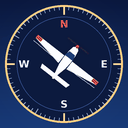
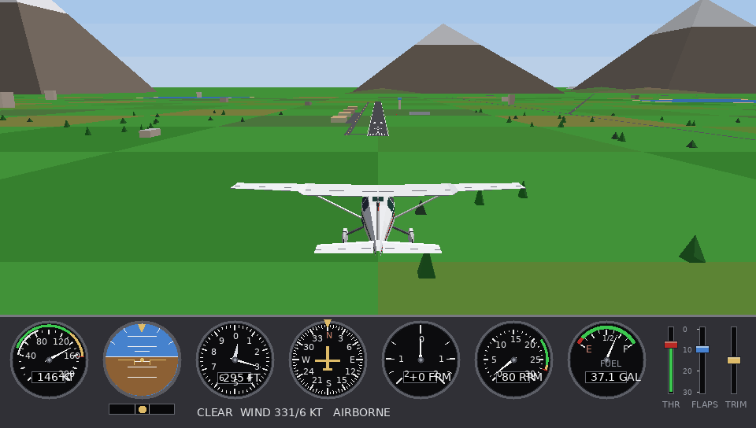
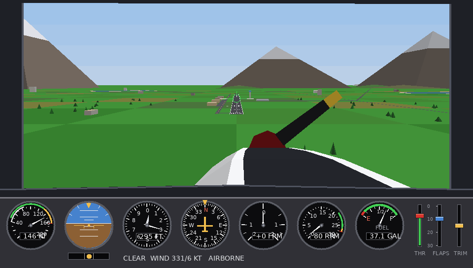
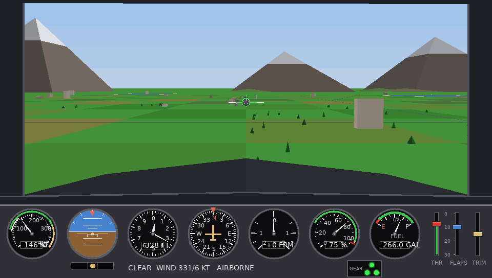
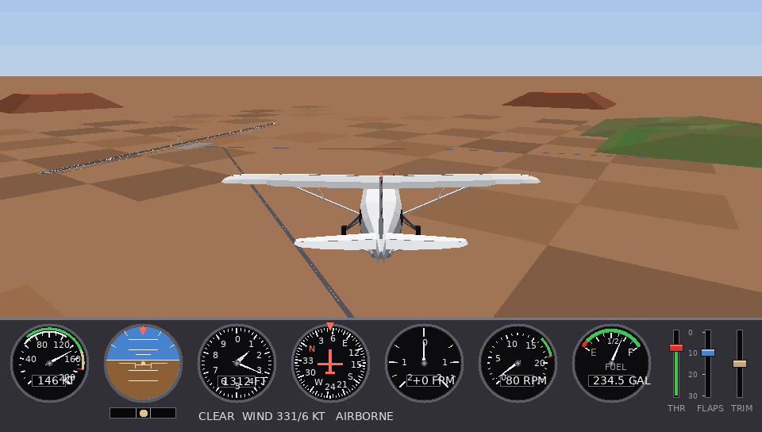
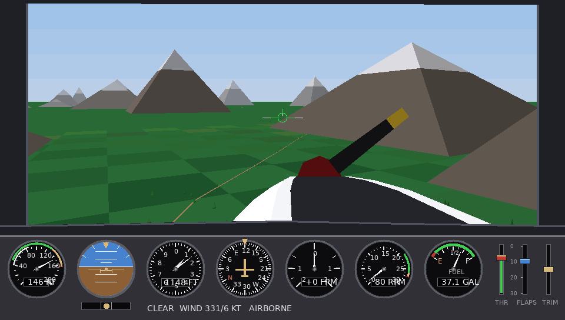
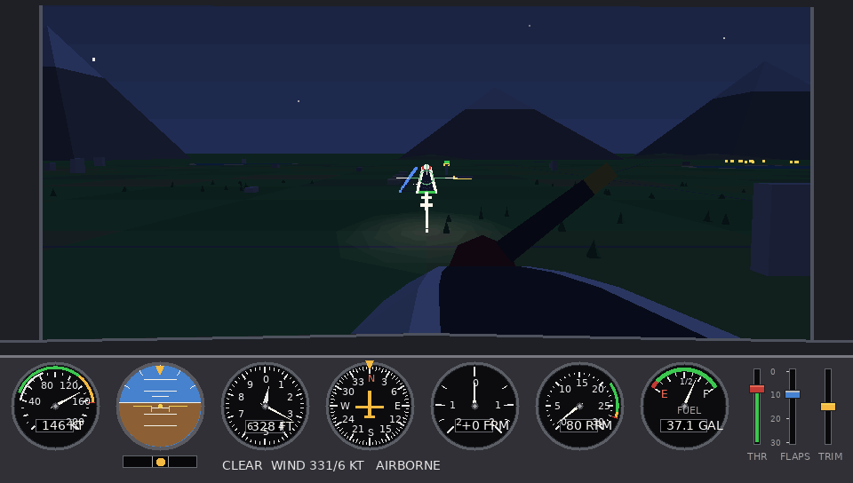
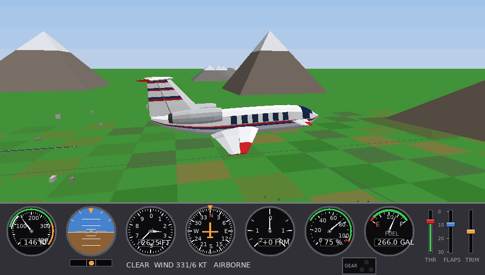

<p align="center">
  
</p>
<h1 align="center">Left Seat</h1>
A flight simulator for the PS Vita in the spirit of the early-90s Microsoft Flight Simulator games: flat-shaded
3D, a working instrument panel and a flight model based on a classic four-seat light trainer.
By Kyle Knowles. Written in C with VitaSDK and vita2d. All 3D is done in software
(projection, clipping and sorting) and drawn as triangles. There are no art or audio assets: the world, the
aircraft and every sound are generated in code.
> Left Seat is a hobby project. The aircraft are fictional designs from "Knowles Aircraft Co." and the airports
> and places are made up. It is homebrew and needs a modified Vita.
Contents
Screenshots
Install
Quick start
Controls
Aircraft
The world
Challenges
Weather, time of day and sound
Cockpit and cameras
Building from source
Reporting a problem
Project layout
Tuning and roadmap
License
Screenshots

	
<br>K-4 cockpit: engine cowling, propeller and the instrument panel	<br>K-30 on approach with the gear down: three green gear lights on the panel
<br>K-10 Hauler over the red desert near Redrock	<br>Approaching the Pinecrest valley between two ridges
<br>Night approach with runway lights and glide-slope lights	<br>The K-30 Courier in the chase view, gear up
Install
You need a PS Vita running custom firmware (for example HENkaku), with VitaShell installed. Left Seat is homebrew
and will not install on an unmodified console. It has been tested on a PS Vita 1000-series.
Download `leftseat.vpk` from the Releases page (or from the `leftseat-vpk` artifact on the
Actions tab, see Building from source).
Copy it to your Vita, for example with VitaShell's USB or FTP mode.
Open it in VitaShell and install it. Left Seat then appears on the LiveArea screen.
Left Seat saves your best challenge scores and sound volume in `ux0:data/skyhawk_scores.txt`, so updating the game keeps them.
Quick start
Open the Hangar and pick an aircraft.
Choose the airport, weather and time of day on the start menu.
Choose Open World to fly freely, or pick a Challenge (see below).
A typical takeoff in the K-4: flaps 10, full throttle, a little right rudder to hold the centre line, rotate at
about 55 kt and climb at about 74 kt. Approach at about 65 kt with full flaps and flare just above the runway.
In the menu, use the D-pad or left stick to move, ✕ to select and left / right on a row to change it. Press START
twice to quit.
Controls
Input	Action
Left stick	Pitch and roll
Right stick up / down	Throttle
Right stick left / right	Rudder
L / R	Look left / right (in the chase view, both together swing the camera round to the front)
D-pad up	Fast forward (free flight only): tap for x2, again for x5, again for normal. Resets on a crash, reset or menu
D-pad down	Wheel brakes on the ground. In the air (above about 100 ft): trim for level flight at your current airspeed. Let go of the stick afterwards
D-pad left / right	Pitch trim: a tap is a fine step (a tenth of a degree), holding speeds up after a moment
○ / ✕	Flaps down / up
□	Landing gear up / down (K-30 only). Refused on the ground and above about 200 kt; takes about 4.5 seconds; landing with it up is a crash
△	Reset the aircraft (restarts the attempt in a challenge)
Select (tap)	Switch camera (cockpit / chase)
Select (hold)	Chart of the whole area
L + R + Select	Invert the pitch axis
START	Pause and return to the menu
Aircraft
Four aircraft, all from Knowles Aircraft Co. Each has its own 3D model, cockpit view, handling, gauges and best
scores. Pick one in the Hangar; it applies to Open World and to every challenge.
Aircraft	What it is	Numbers
K-4 Trainer	Slow, forgiving piston four-seater	Stall about 53 kt clean, 48 kt with full flaps
K-10 Hauler	Big turboprop, about three times the weight	Cruise about 175 kt (Redrock in about 5.5 minutes instead of 9), climb about 970 fpm, stall 56 kt with full flaps, 335 gallons
Jet 1 Sprint	Tiny single-seat jet: turbojet on top of the rear fuselage, V-tail, bubble canopy	Cruise 210 kt, climb about 1,700 fpm, stall 56 kt (50 kt with flaps). The engine takes a couple of seconds to answer the throttle and the exhaust glows when it works hard
K-30 Courier	Twin-engine jet with a T-tail, nose canards and retractable gear	Rotates at about 100 kt, cruises about 320 kt, stalls at 82 kt. One throttle drives both engines
The K-30's gear is raised and lowered with □. Raise it once you are climbing and lower it before you land. Three
gear lights sit on the panel between the engine gauge and the fuel gauge, like a jet's: three green when the gear
is down and locked, red while it moves, dark when it is up.
The flight model covers lift, drag, thrust and stalls tuned toward the published figures of typical aircraft,
flaps in four steps, trim, fuel burn, engine torque and adverse yaw. The wheels are springs and dampers, so
touchdowns are gradual and bounces happen. A bad landing (too hard, sideways, or a wingtip, tail or propeller
strike) is a crash.
The world
Three airports and the country between them. Hold Select for a chart of the whole area showing the airports,
your position and heading, your track so far, and the bearing and distance to each airport.
Airport	Where	Description
Knowles Field (KAK)	Home	Runway with numbers and aiming-point markings, edge and end lights, glide-slope (PAPI) lights, taxiway and apron, a terminal and hangars
Redrock Municipal (RDR)	About 29 km north-north-east of KAK	Runway 07/25, apron, terminal, tower and hangars, and a beacon you can see from far away at night. The farmland turns to red desert with buttes around it
Pinecrest Airstrip (PNC)	About 21 km west-north-west of KAK	A 650 m mown-grass strip (runway 12/30, no markings) with a small hangar and cabin, in a forested valley between two ridges. After dark it has low runway lights; from far away you need the chart
Between KAK and RDR there is a mountain pass, low hills, towns, a highway, and a river that runs on to a lake at
its mouth. Roads wind through the countryside and some of them cross the river on bridges. The towns have
streets and a central plaza. Elsewhere there are patchwork fields, more lakes with sandy shores and patches of
forest. A windsock by each runway shows the wind.
Challenges
Pick one from the menu. Each is scored out of 100 on the touchdown: sink rate (40), distance from the centre line
(25), touchdown point (25) and heading and bank (10), minus penalties for bounces and a nose-wheel-first landing.
A crash scores 0. Your best score for each is saved to `ux0:data/skyhawk_scores.txt`. The weather and time of day
chosen on the menu apply to all of them.
Challenge	What happens
Landing	You start about 4.5 km out on final approach, a little off line and height. The chosen weather stays fixed during the attempt
Engine out	The engine fails at about 1,500 ft, 3 to 3.7 km from the runway and off to one side. Glide at about 70 kt, use flaps to lose height, and land. The scoring window for the touchdown point is wider
Crosswind	A strong wind (about 11 kt at the ground, 27 kt higher up, with gusts) blows across the runway from the left or right. Crab into it, then straighten with rudder before touchdown
Cross-country	Take off from Knowles Field, fly to Redrock and land on its runway from either end. The HUD shows bearing and distance. The result card also shows trip time and fuel used. Landing anywhere else scores 0
Backcountry	The same trip, but to Pinecrest: find the grass strip in the mountains and put it down in the first few hundred feet. The scoring area shrinks with the runway, so touching down early matters more
Weather, time of day and sound
Weather: choose clear, breezy, overcast, fog, rain or storm and it stays that way for the whole flight.
Choose random and the weather starts anywhere and drifts from one kind to another over time. Wind, gusts and
turbulence affect the aircraft, clouds drift and can be flown through, fog cuts visibility, rain falls with the
wind (straight down when you are parked, slanting back as you fly, sideways past a window) and storms flash with
lightning. The panel shows the weather, wind and whether you are on the ground or airborne.
Time of day: day, dusk or night. Dusk has a glowing orange horizon, a low sun and warm light. Night has a
dark sky with a moon and stars, lit airports (runway edge and threshold lights, approach lights, taxiway lights,
tower beacon and windows), glowing glide-slope lights and your landing light.
Sound: every sound is made on the fly from what the aircraft is doing, so there are no audio files. There is
a piston engine with a lumpy idle (K-4), a turboprop throb (K-10) and a jet whine and roar (Jet 1, K-30), each
following its engine speed; air noise that rises with speed and gusts; a stall warning horn a few knots before the
stall; rain and thunder; tyre chirp and thump, rolling rumble (rougher on grass) and brake squeal; the flap motor;
a sputter when the engine fails; a crash; jingles for good, fair and poor landings; and menu clicks. The cockpit
view is more muffled than the chase view. The SOUND row in the menu sets the volume (OFF, LOW, MEDIUM, HIGH) and
is remembered between sessions. If the sound hardware cannot be opened the game simply runs silent.
Cockpit and cameras
Two cameras, switched with Select. In the cockpit you sit in the left seat with the engine cowling and
propeller blur ahead of you. A windshield and door frame slide across as you look left or right with the
triggers, and the wings, struts and moving flaps and ailerons show out of the side windows. The chase view
shows the detailed 3D aircraft with moving control surfaces, flaps and propeller.
The instrument panel has round gauges (airspeed indicator with coloured arcs, attitude indicator, altimeter with
two hands, rotating-card heading indicator, vertical speed, engine speed and fuel), a slip indicator, and
throttle, flap and trim levers.
Building from source
You need VitaSDK (with the `vita2d` package), CMake and, optionally, Python 3 (it cleans
the PNG icons before packaging).
```sh
git clone https://github.com/<your-username>/leftseat.git
cd leftseat
mkdir build && cd build
cmake ..
bash ../fixpad.sh      # builds leftseat.vpk; use this instead of plain make
```
The result is `build/leftseat.vpk`.
Building on GitHub
You do not need VitaSDK on your own machine. Every push builds `leftseat.vpk` with GitHub Actions: open the
repository's Actions tab, open the latest run and download the `leftseat-vpk` artifact (a zip containing the
VPK). Pushing a tag such as `v1.0` also attaches the VPK to a Release. See `GITHUB_GUIDE.md` for a step-by-step
walkthrough.
Troubleshooting
`vita-elf-create: Cannot allocate ... bytes for SCE data at end of segment 0; segment 1 overlaps`
The converter sometimes needs a little free space after the code. `fixpad.sh` measures it and grows the padding
array in `src/pad.c` until it fits, then builds. It may edit `src/pad.c`; that is expected.
The app icon is white. Extra metadata blocks inside a PNG can make the Vita's icon loader fail.
`tools/strip_png.py` removes them, and CMake runs it on the icon and LiveArea images every time it configures.
By hand: `python3 tools/strip_png.py in.png out.png`.
Logs. The game writes `ux0:data/skyhawk.log` with a few startup lines, a crash reason after a crash, and
frame timings every 300 frames.
Reporting a problem
Found a bug? Open an issue on the repository's Issues tab and say:
what you were doing (aircraft, airport, weather, time of day, and where in the world);
what you expected and what happened;
your Vita model and firmware version;
the game version (shown on the release you installed);
the log file `ux0:data/skyhawk.log`, attached to the issue. It holds a few startup lines, a crash reason and
frame timings.
Project layout
`src/main.c` includes the other source files in order, so the game is built as one unit. The files are split by
topic.
```
src/main.c         entry point and main loop; includes the files below
src/defs.inc       constants, types and global state
src/aircraft.inc   every number that makes one aircraft handle differently from another
src/mathx.inc      vector and number helpers
src/batch.inc      collecting triangles and sending them to the GPU
src/weather.inc    weather state, wind, fog and sky colours
src/clip2d.inc     2D polygon clipping and filling
src/camera.inc     3D camera and projection
src/world.inc      static world (buildings, hills, towers, roads, bridges) and collisions
src/flight.inc     aircraft state, control shaping, crash handling
src/gear.inc       landing gear, tyre friction, ground strikes
src/challenge.inc  challenges: starts, scoring and the best-score file
src/update.inc     per-frame flight update (inputs, aerodynamics, ground roll)
src/models.inc     3D K-4 model, cockpit nose, shadow
src/modelkit.inc   kit for smooth models: lofted fuselages, airfoil wings, tail surfaces, tyres
src/k10.inc        3D K-10 model and cockpit parts
src/jet1.inc       3D Jet 1 model and cockpit parts
src/k30.inc        3D K-30 model (twin engines, T-tail, canards, retractable gear) and cockpit parts
src/fleet.inc      chooses the model for the aircraft being flown
src/soundcore.inc  the sound engine: makes every sound on the fly (knows nothing about the Vita)
src/sound.inc      plays it on a background thread and tells it what the aircraft is doing
src/sky.inc        clouds, windsock, rain
src/scenery.inc    fields, lakes, trees, airport detail, cockpit frame
src/night.inc      dusk and night: sky, sun, moon, stars, airport lights, landing light
src/airports.inc   Redrock, the highway, river, country roads, town streets and bridges
src/scene.inc      drawing one frame of the 3D scene
src/panel.inc      instrument panel and gear lights
src/overlays.inc   on-screen messages and warnings
src/chart.inc      the chart shown while holding Select
src/menu.inc       start menu and the landing result card
src/pad.c          padding used by fixpad.sh
fixpad.sh          build helper
tools/strip_png.py removes extra chunks from PNG files
docs/images/       screenshots used in this README
sce_sys/           icon and LiveArea images and template
CMakeLists.txt     build file
```
Tuning and roadmap
If the frame rate dips, these are the first things to turn down (near the top of `defs.inc` and `scenery.inc`):
Setting	Effect
`WORLD_DETAIL` (defs.inc)	2 = everything (default), 1 = no towns, buttes or river, 0 = only the airports and the original mountains
`TREE_LIMIT` (scenery.inc)	most trees drawn at once; 0 turns them off
`COCKPIT_FRAME` / `COCKPIT_NOSE` (scenery.inc)	the window frame and engine cowling in the cockpit view
`MODEL_DETAIL` (k10.inc)	2 = full K-10 model (default), 1 = lighter, about 550 fewer vertices in the chase view
`TILE_R` (defs.inc)	how many ground tiles are drawn around you
Ideas for later: more aircraft (a row in the table in `aircraft.inc` and a model are all a new one needs), ring
courses, real rolling terrain and more airports.
License
MIT, see LICENSE.
